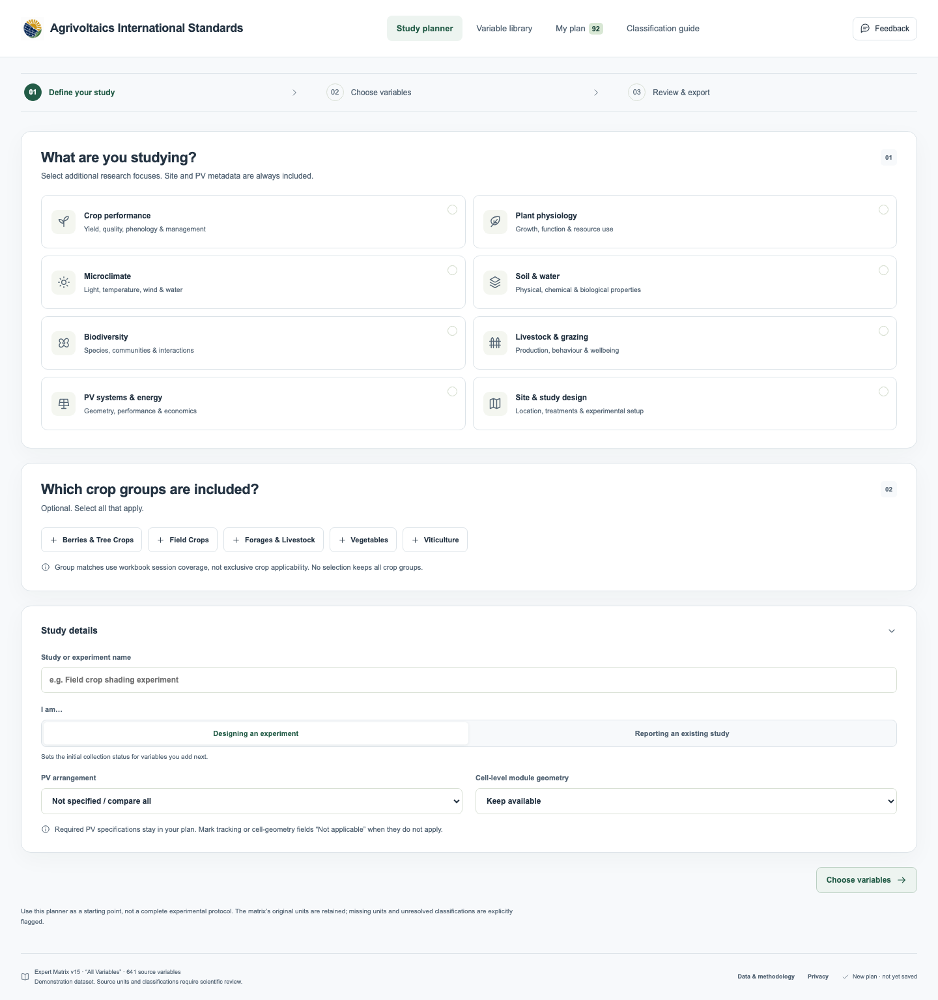

# Agrivoltaics International Standards

[Open the planner](https://saltysaguaro.github.io/agrivoltaics-international-standards/) · [GitHub repository](https://github.com/saltysaguaro/agrivoltaics-international-standards)

A static, browser-based research planner built from all **641 variables** in the first worksheet of `Agrivoltaics_Expert_Matrix_Summary_15.xlsx`. Designed for demonstration and scientific feedback, not as an endorsed or validated experimental protocol.



## Researcher workflow

1. **Define the study:** choose research focuses, crop groups, and PV configuration. New plans include all 26 CD/CU variables plus required site, study-design, and PV metadata (92 selected records in total; one CD record overlaps the 67 required metadata records). Required records cannot be removed. Mark conditional fields not applicable and explain in their notes.
2. **Choose variables:** switch between list and tile views, search by full name or abbreviation in the library or study shortlist, use the domain tabs above the results and the sidebar filters for priority, subcategory, unit status, and vote evidence. The default order is field-site metadata, PV systems, microclimate, soil, crops, livestock, then biodiversity. Full names and a separate abbreviation column keep labels readable. Open any variable for original units, source notes, the full anonymous vote ledger, and method/publication slots.
3. **Review and export:** enter reporting units, sampling schedules, positions, methods, collection status, and notes. Export a measurement-plan CSV, portable JSON plan, or blank observation template; print the plan. JSON can be imported to resume work.

Selections persist locally when browser storage is available. Study plans are not uploaded. The prominent Give feedback button opens the project’s Google Form in a new tab for comments, participation requests, missing variables, and research resources. Only information submitted in that form is sent to the project team. Variable-specific corrections still prepare a GitHub issue for the user to submit, or download Markdown when no repository is configured. No account, analytics, API keys, or external runtime dependencies are required.

## Important data findings

| Result | Variables |
| --- | ---: |
| CD · Core / Descriptive | 13 |
| CU · Core / Universal | 13 |
| E · Enhanced | 171 |
| S · Supplemental | 83 |
| Legacy C · core subtype pending | 245 |
| No category reaches 50% | 75 |
| 50/50 tie | 14 |
| No non-NA votes | 27 |
| **Total** | **641** |

The library combines existing C, CU, and CD classifications into **Core (271)**, alongside **Enhanced (171)**, **Supplemental (83)**, and **Needs review (116)**. This is a display/filter grouping: expert votes are not pooled, original classifications remain unchanged, and source C is not assigned a descriptive or universal subtype. The source-level audit retains its original totals: 280 CD/CU/E/S classifications and 361 records without one of those four exact classifications. Saved selections and the 92-variable default plan are unchanged.

Each expert-by-session cell is one voting unit; NA, N/A, and blank cells are ignored. Mixed/conditional non-NA entries remain in the denominator but support no category. A unique category at exactly 50% qualifies; an exact two-way 50/50 split does not. See [the full methodology](docs/METHODOLOGY.md).

**339** variables have no source unit and **9** have `TBD`. Original units are retained, not silently standardized. Additional ambiguity warnings bring the total requiring a unit decision to **383**. Researcher-entered units are saved separately. No literature links or validated methods have been invented.

## Run locally

The repository already contains the processed data; the workbook is not needed to run the tool.

```sh
# From this repository's root, with Python 3.10+ installed:
python3 -m http.server 8000 --bind 127.0.0.1
```

Open `http://127.0.0.1:8000`. Do not double-click the repository's `index.html`: its module imports and dataset fetch require HTTP. For a single file that can be opened directly, build the standalone demo below.

## Test and build

Node.js 22+ and Python 3.10+ are required for development. No `npm install` is needed; the project has no npm dependencies.

```sh
npm test             # Node and Python unit/integration tests
npm run build        # Validates votes and builds _site/ for hosting
npm run demo         # Also creates dist/agrivoltaics-standards-demo.html
npm run serve        # Optional local HTTP server at port 8000
```

Browser tests use a pinned development-only Playwright installation and run in the Pages workflow; see [test report](docs/TEST_REPORT.md). The application itself does not need Playwright.

## Publish on GitHub Pages

Commit the extracted repository contents, **including `.github/`**, to the `main` branch of a repository. In **Settings → Pages → Build and deployment → Source**, choose **GitHub Actions**. Run the included **Test and deploy Pages** workflow (or push another commit). It tests and publishes only `_site/`.

Use [the deployment guide](docs/DEPLOYMENT.md) for the full procedure, configuration, privacy considerations, and troubleshooting. This repository publishes the planner through the included Pages workflow. Data licensing and attribution are documented in [DATA_NOTICE.md](DATA_NOTICE.md).

## Maintain the matrix and resources

```sh
python3 scripts/import_matrix.py /path/to/Agrivoltaics_Expert_Matrix_Summary_15.xlsx \
  --date 2026-10-14
npm test
npm run demo
```

The importer reads the first worksheet only, checks the source structure, preserves raw votes and units, and replaces expert initials with anonymous column-position IDs. The original workbook is intentionally excluded from public assets and Git. Review changes to identifiers, classification totals, and the audit before merging a new matrix version.

Reviewed methods and publications belong in `data/curation.json`, keyed by stable variable ID. Reimporting applies this overlay without changing source votes. See [curation instructions](docs/CURATION.md) and [data dictionary](docs/DATA_DICTIONARY.md).

## Repository map

```text
index.html                     Accessible application shell
assets/app.js                  UI, interaction, persistence, feedback
assets/core.mjs                Pure classification, filtering, ranking, export logic
assets/styles.css              Responsive screen and print styles
assets/config.js                Brand and optional repository URL
standards_logo.png             Supplied PNG brand logo and favicon
data/variables.json             All 641 source-auditable variable records
data/curation.json              Reviewed method/publication overlay
data/classification-audit.csv   Reproducible classification and units audit
data/quality-summary.json       Counts and data-quality summary
scripts/import_matrix.py        Dependency-free, values-only XLSX importer
scripts/build.mjs               Public-site and single-file builds
tests/                         Classification, data, export, import and browser checks
.github/workflows/pages.yml    Test/build/deploy workflow
.github/ISSUE_TEMPLATE/         Structured variable corrections and tool feedback
docs/                          Methodology, data model, curation, deployment, test report
```

## Scientific review priorities

Resolve legacy `C` to CD/CU through a documented expert review, reconcile ambiguous/conditional cells, and define reporting quantities/units with measurement context. Review the topic/session applicability mapping with crop and domain experts. Add reviewed methods and publications with attribution, then run usability and cross-browser accessibility testing before calling the tool a standard.

Application code is offered under the MIT license. Source-derived research data is **not** relicensed by that software license; see [DATA_NOTICE.md](DATA_NOTICE.md).
